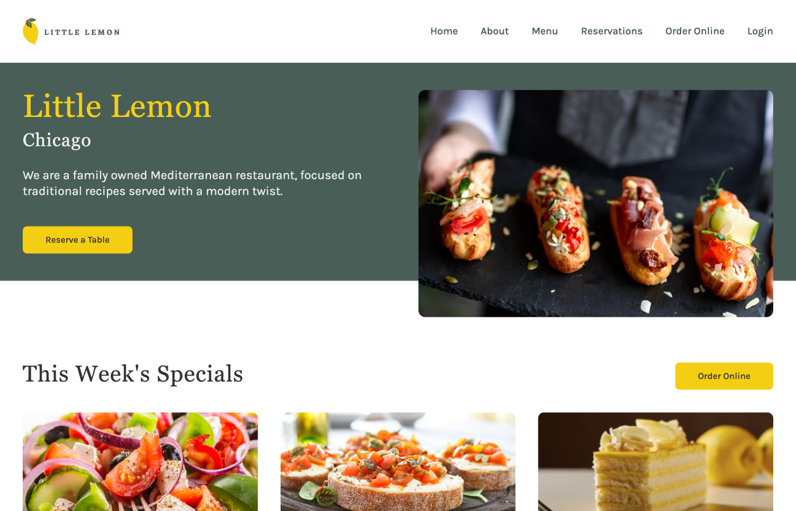

# Little Lemon Restaurant

A responsive restaurant website and table reservation application built with React as the capstone project for the Meta Front-End Developer Professional Certificate.

The application allows users to browse the Little Lemon restaurant homepage and reserve a table using an interactive booking form with dynamically generated reservation times and form validation.



## Features

- Responsive restaurant homepage
- Mobile navigation menu
- Table reservation form
- Dynamically generated available reservation times
- Form validation and user feedback
- Booking confirmation page
- Accessible semantic HTML and ARIA attributes
- Responsive layouts for desktop, tablet, and mobile
- Unit tests for booking functionality and validation

## Technologies

- React
- JavaScript
- HTML5
- CSS3
- React Router
- Jest
- React Testing Library
- Font Awesome

## Project Structure

```text
src/
├── App.js
├── BookingForm.js
├── BookingPage.js
├── CallToAction.js
├── Chicago.js
├── ConfirmedBooking.js
├── CustomersSay.js
├── Footer.js
├── Header.js
├── Homepage.js
├── Main.js
├── Nav.js
├── Specials.js
├── api.js
├── bookingUtils.js
├── App.css
├── App.test.js
└── images/
```

## Installation

Clone the repository and install the project dependencies:

```bash
git clone https://github.com/dlewisSTL/Little-Lemon-Restaurant
cd Little-Lemon-Restaurant
npm install
```

## Running the Application

Start the development server:

```bash
npm start
```

The application will open in your browser in development mode.

## Running Tests

Run the test suite with:

```bash
npm test
```

The project includes tests for:

- Rendering the booking form
- Initializing available reservation times
- Updating reservation times when the selected date changes
- HTML5 form validation attributes
- Disabling submission when the form is invalid
- Enabling submission when the form is valid

## Booking Functionality

Available reservation times are generated based on the selected date. The booking form validates the reservation date, time, number of guests, and occasion before allowing submission.

Successful reservations navigate the user to a booking confirmation page.

## Accessibility

The application uses semantic HTML, explicitly associated form labels, accessible navigation controls, ARIA attributes where appropriate, keyboard-accessible controls, and validation feedback designed to work with assistive technologies.

## Responsive Design

The interface adapts across desktop, tablet, and mobile screen sizes. The mobile layout includes a collapsible navigation menu and responsive versions of the homepage, booking form, and confirmation page.

## About the Project

This project was created for the Front-End Developer Capstone course in the Meta Front-End Developer Professional Certificate.

The original Little Lemon concept and project requirements were provided as part of the course. The interface was implemented and refined as a React application with responsive styling, accessibility improvements, booking functionality, validation, and testing.
